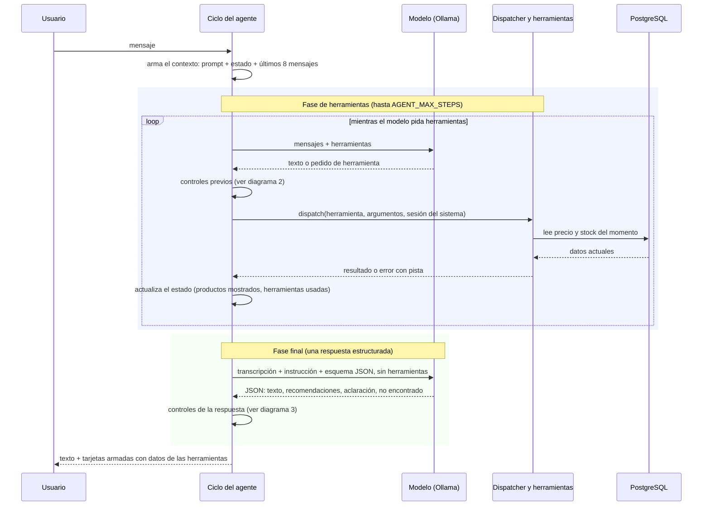
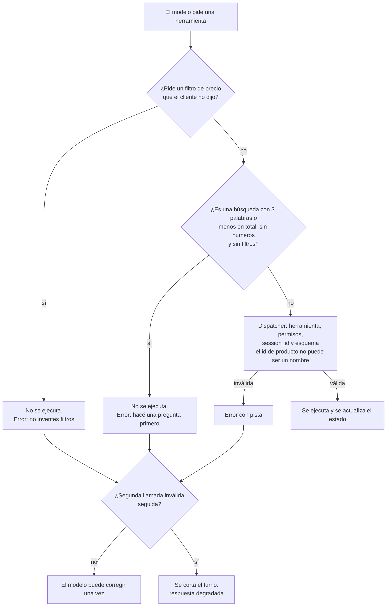
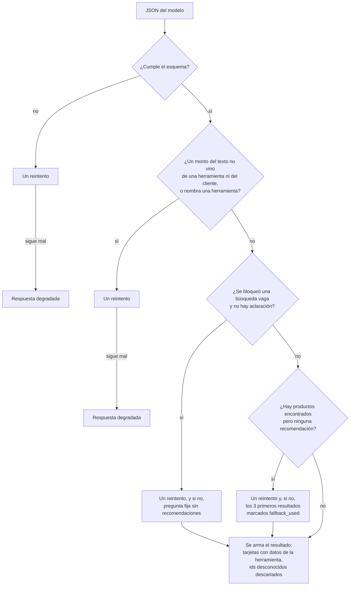
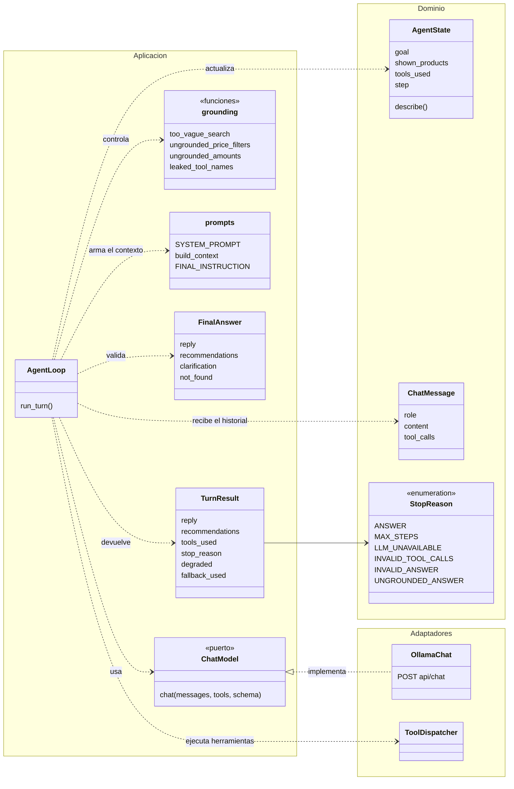

# Flujo de un turno del asistente

Estos diagramas muestran lo que está implementado en el ciclo del agente (decisión 0009). El endpoint de chat invoca este ciclo, guarda el estado entre mensajes y arma los bloques de la respuesta (ver `chat-flow.md`).

## 1. Un turno, de punta a punta

Si el modelo no responde, o se alcanza el máximo de pasos, el ciclo devuelve un mensaje fijo en español y marca el resultado como degradado. El ciclo no deja una excepción en manos del usuario.

## 2. Controles antes de ejecutar una herramienta

## 3. Controles de la respuesta final

## 4. Clases

`AgentState` guarda lo que el asistente necesita recordar (productos mostrados en orden, herramientas usadas, paso) y no la conversación. El historial de mensajes es otra cosa: llega como parámetro y se recorta a los últimos mensajes.
