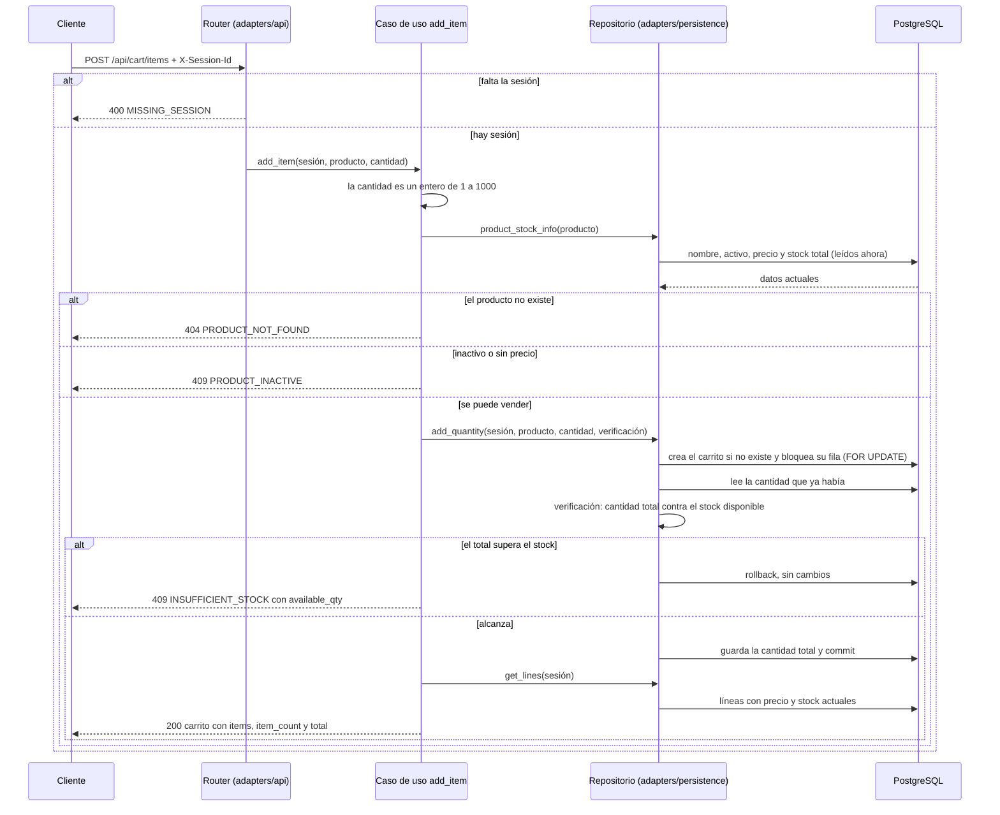
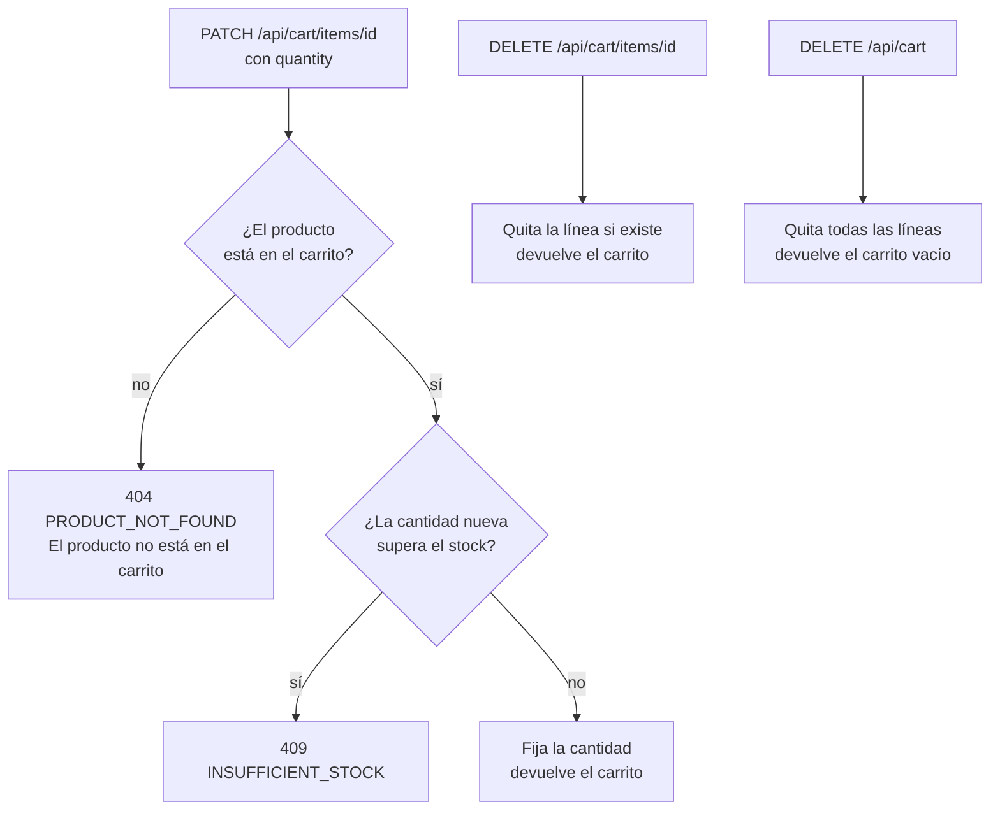
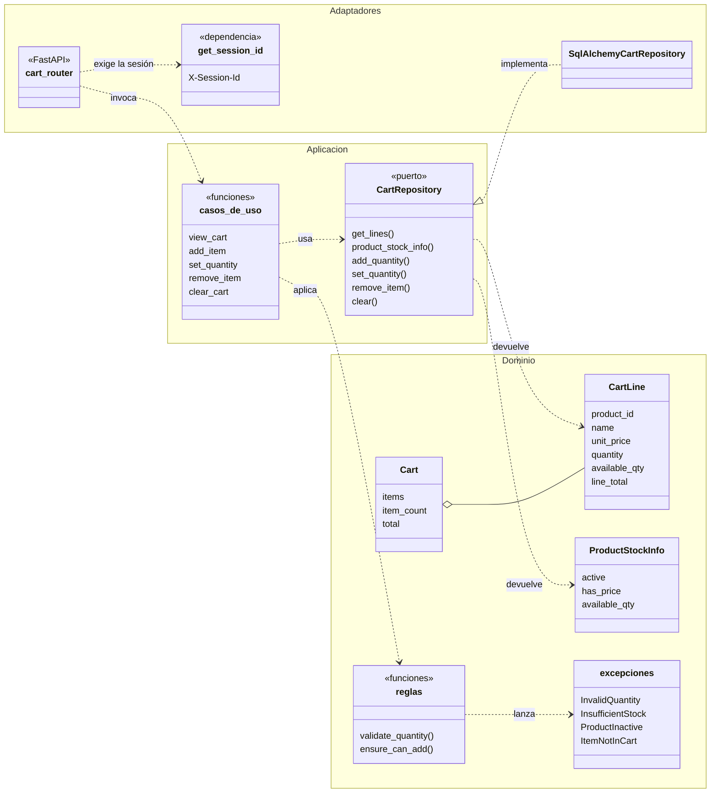

# Flujo del carrito

Estos diagramas muestran lo que está implementado en el carrito (decisión 0006). Cada pedido lleva el encabezado `X-Session-Id`, que identifica el carrito.

## 1. Agregar un producto

`POST /api/cart/items` con `{ "product_id": "...", "quantity": 2 }`

El carrito no cambia el stock: solo lo consulta. El stock se descuenta al confirmar la compra.

## 2. Cambiar la cantidad, quitar y vaciar

Quitar es idempotente: quitar un producto que no está devuelve el carrito sin cambios.

## 3. Clases

`Cart` y `CartLine` calculan el subtotal, el total y la cantidad de unidades. No guardan nada: el precio llega del repositorio en cada lectura.
