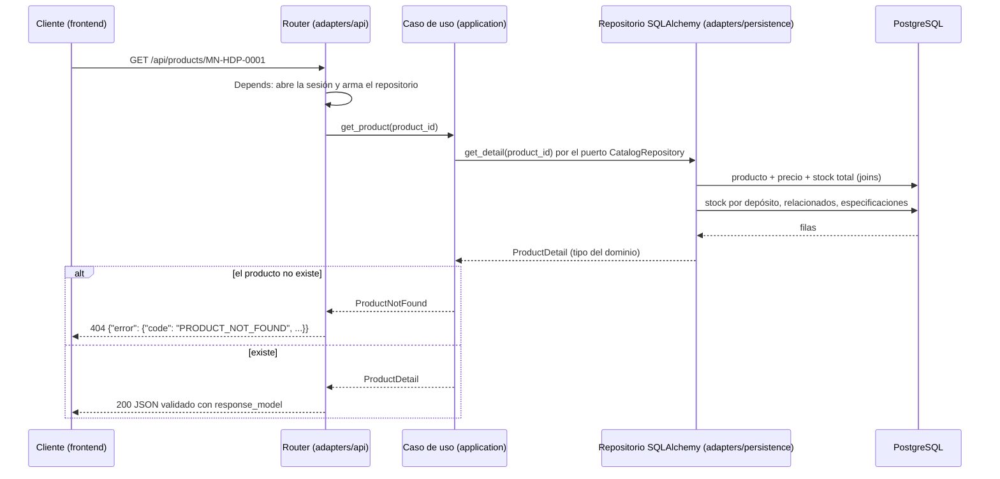
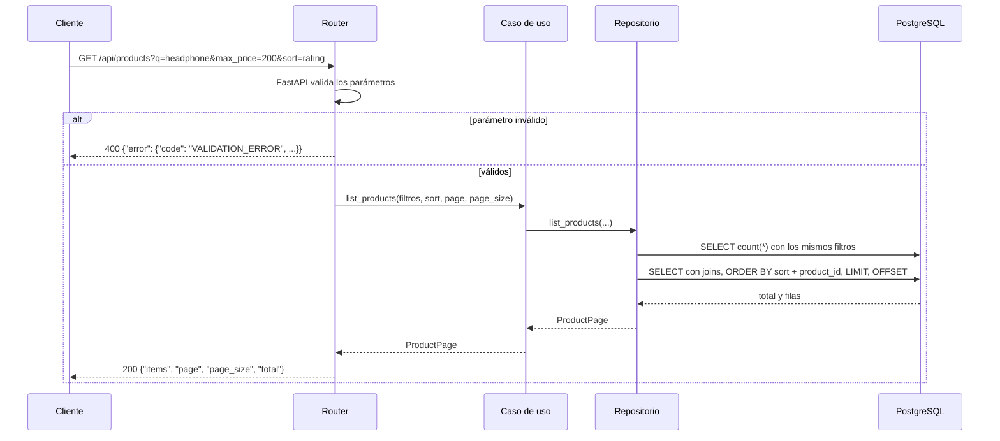

# Flujo de un pedido a la API de catálogo

Estos diagramas muestran cómo viaja un pedido por las capas del backend, tal como está implementado. Cada capa solo conoce a la de abajo a través de un puerto (interfaz): el dominio no importa FastAPI ni SQLAlchemy.

## Detalle de un producto

`GET /api/products/{product_id}`



## Listado con filtros

`GET /api/products?q=headphone&max_price=200&sort=rating&page=1`



## Comparación

`GET /api/products/compare?ids=A,B`

El caso de uso pide al repositorio los productos y sus especificaciones, y arma la tabla de atributos con datos del dominio, no con SQL:

```mermaid
sequenceDiagram
    participant C as Cliente
    participant R as Router
    participant U as Caso de uso
    participant A as Repositorio

    C->>R: GET /api/products/compare?ids=A,B
    R->>U: compare_products([A, B])
    U->>U: descarta ids repetidos y exige de 2 a 4
    U->>A: get_summaries([A, B]) y get_specifications([A, B])
    A-->>U: resúmenes y especificaciones
    alt falta algún id
        U-->>R: ProductNotFound
        R-->>C: 404 PRODUCT_NOT_FOUND
    else todos existen
        U->>U: une los atributos por (grupo, nombre); el faltante vale null
        U-->>R: Comparison
        R-->>C: 200 {"products": [...], "attributes": [...]}
    end
```

El router de `compare` se declara antes que el de `/{product_id}`. Si no, FastAPI tomaría `compare` como un identificador de producto.
