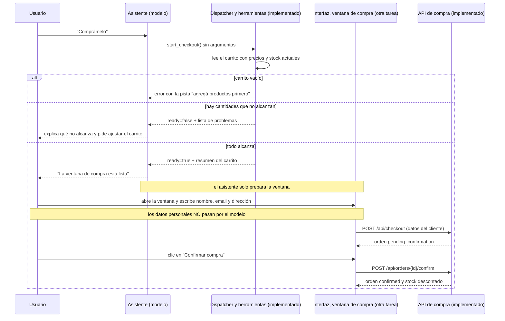

# Flujo de "comprámelo" en el chat

Este diagrama muestra cómo se prepara una compra desde el chat (decisión 0008). Las herramientas `view_cart`, `add_to_cart` y `start_checkout` ya existen. El ciclo del agente, el endpoint de chat y la ventana de confirmación son otras tareas: acá se dibuja el flujo completo para ver dónde pasan los datos personales, y cada parte indica si está implementada.

## 1. Quién ve qué

## 2. Qué intenta el modelo y qué responde el dispatcher

| El modelo intenta | Respuesta del dispatcher |
|---|---|
| `start_checkout` con `name` y `email` | Rechaza los campos de más: la herramienta no tiene argumentos |
| `view_cart` con un `session_id` | "session_id lo pone el sistema" |
| `confirm_order` o `cancel_order` | "No disponible para el asistente: confirma el usuario en la interfaz" |
| `add_to_cart` con 50 unidades y 9 en stock | "Solo hay 9 unidades", y sugiere una cantidad menor o alternativas |
| `add_to_cart` de un producto inexistente | "Producto no encontrado", y sugiere buscarlo con `search_products` |
| `start_checkout` con el carrito vacío | "El carrito está vacío", y sugiere agregar productos primero |

El modelo nunca crea una orden, nunca confirma una compra y nunca recibe datos personales.
