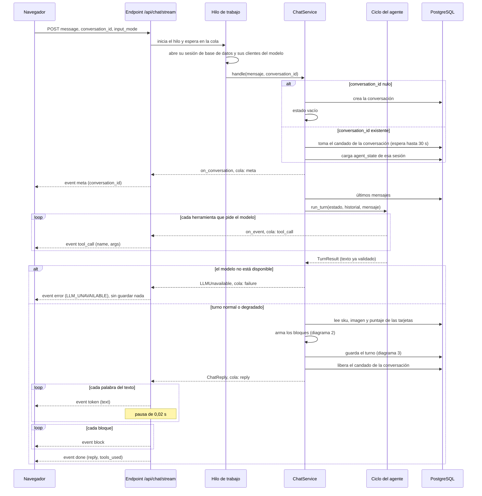
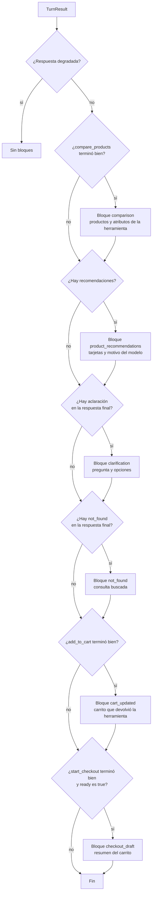
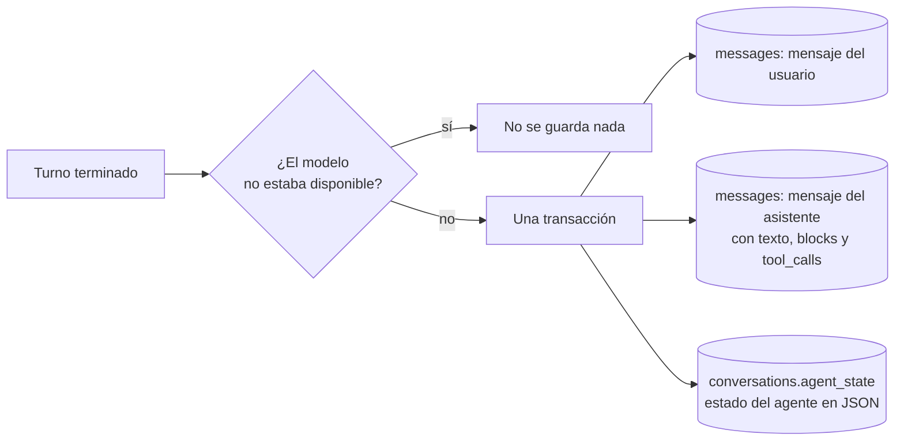

# Flujo del endpoint de chat

Estos diagramas muestran lo que está implementado en el endpoint de chat (decisión 0010): cómo viaja un mensaje, cómo se arman los bloques y qué se guarda en la base. El ciclo del agente que corre adentro está en `agent-flow.md`.

## 1. `POST /api/chat/stream`, de punta a punta

El turno corre en un hilo aparte y el hilo principal va enviando los eventos al navegador a medida que llegan por una cola. El hilo abre y cierra sus propios recursos (sesión de base de datos y clientes del modelo), y siempre deja un evento final en la cola; si el hilo muriera sin dejarlo, el generador lo detecta y envía un evento `error` (INTERNAL_ERROR).

Si otro turno de la misma conversación sigue corriendo y no termina en 30 s, el segundo no se ejecuta: llega un evento `error` con el código `CONVERSATION_BUSY` (409 en el endpoint sin stream) y no se guarda nada. El candado se libera siempre al terminar el turno, también cuando falla (decisión 0012).

Cualquier otro fallo del turno (conversación inexistente, mensaje inválido, error inesperado) también llega como un evento `error`, con otro código. La respuesta HTTP ya empezó con estado 200, así que el error viaja dentro del flujo. Si el fallo ocurre antes de empezar a transmitir, por ejemplo por un encabezado `X-Session-Id` ausente, responde con un error HTTP normal.

## 2. Cómo se arman los bloques

Los arma el software a partir del resultado del turno (`TurnResult`) y de los resultados de las herramientas. El modelo no escribe los bloques.

Las tarjetas de `comparison` y de `product_recommendations` se completan con `sku`, `image_url`, `rating` y `review_count`, que se leen del catálogo en una sola consulta. El nombre, el precio y el stock quedan como los devolvió la herramienta en ese turno. Si un producto no se encuentra en el catálogo, esos cuatro campos van en `null`. Cuando una herramienta se llamó varias veces, se usa el último resultado correcto. Si `start_checkout` devuelve `ready: false`, no hay bloque `checkout_draft`.

## 3. Qué se guarda en cada turno

Todo se guarda en una sola transacción, después de que el turno terminó bien.

- `tool_calls` guarda, por cada herramienta, el nombre, los argumentos, si salió bien (`ok`) y la duración (`duration_ms`). No guarda el resultado.
- `agent_state` guarda el objetivo, los productos mostrados en orden (id y nombre), las herramientas usadas y el paso. Se lee al empezar el turno siguiente.
- Un turno degradado (por ejemplo, por llegar al máximo de pasos) sí se guarda, con el mensaje fijo y sin bloques.
- Si el modelo no está disponible no se guarda ni el mensaje del usuario. Cuando la conversación se creó en ese mismo pedido, la fila de la conversación queda vacía, porque se confirma antes de correr el turno.
- `input_mode` se valida pero no se guarda.
