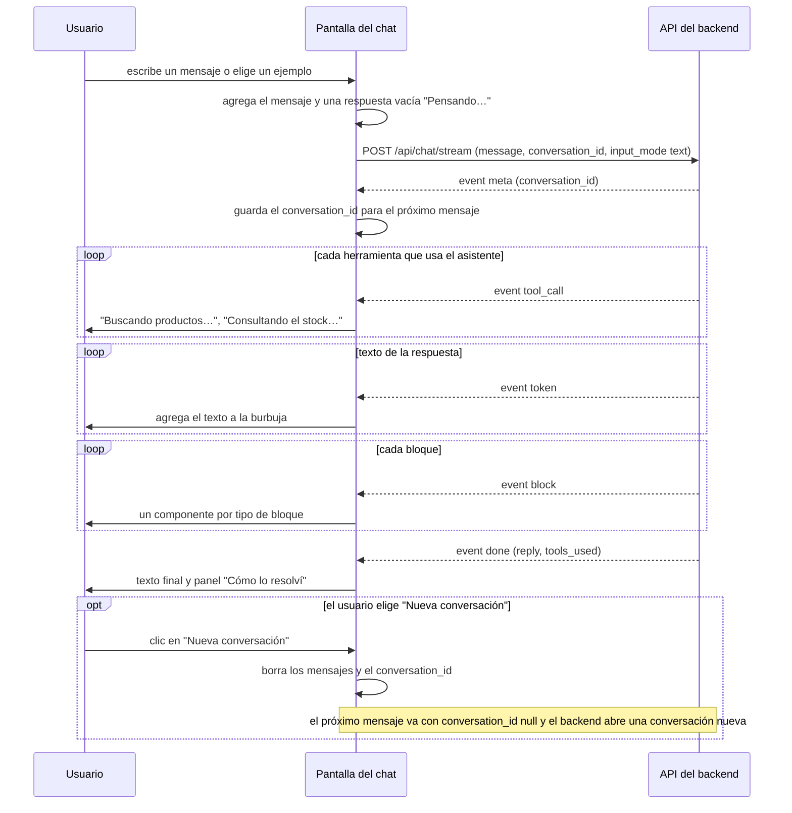
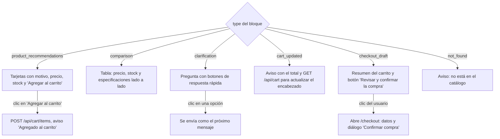
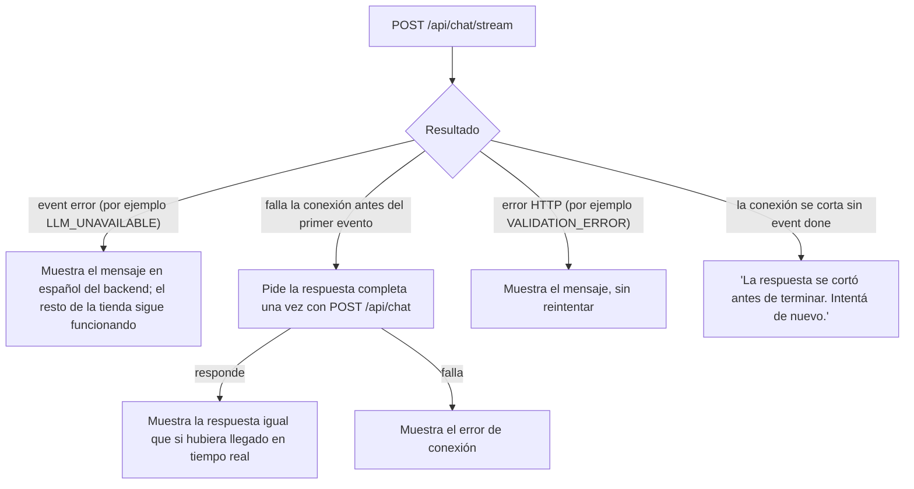

# Flujo del chat en la interfaz

Este diagrama muestra lo que hace la pantalla del asistente (`/chat`) y qué endpoints llama. Lo que pasa dentro de `POST /api/chat/stream` está en `chat-flow.md`.

## 1. Un mensaje, de punta a punta

La pantalla lee la respuesta con `fetch` y no con `EventSource`, porque el pedido es un POST (ver el contrato de la API, sección "Asistente"). Cada evento se muestra apenas llega: el usuario ve qué herramienta está usando el asistente y el texto mientras se escribe.



## 2. Qué hace cada bloque



El chat nunca confirma una compra. El bloque `checkout_draft` solo lleva a la pantalla de checkout, donde la orden se registra únicamente con el clic en "Confirmar compra" (confirmación explícita de la compra, RF-12). Las respuestas rápidas solo funcionan en la última respuesta, para no contestar dos veces la misma pregunta.

## 3. Qué muestra la pantalla cuando algo falla



Mientras una respuesta se escribe, el botón "Enviar" queda deshabilitado: el asistente atiende un mensaje por vez. La conversación vive en la memoria de la aplicación, así que se mantiene al ir al carrito y volver, pero se pierde al recargar la página.

## 4. Consulta por voz

El botón del micrófono, junto a "Enviar", cubre la entrada por voz (RF-08). El navegador graba con `MediaRecorder`, que en Chrome produce audio webm con códec Opus. La pantalla manda ese audio a `POST /api/transcribe`, y lo que pasa adentro de ese endpoint está en `transcribe-flow.md`. El texto que vuelve se envía como un mensaje más, con `input_mode: "voice"`, y desde ahí sigue el diagrama 1.

```mermaid
sequenceDiagram
    participant U as Usuario
    participant F as Pantalla del chat
    participant N as Navegador (micrófono)
    participant API as API del backend

    U->>F: toca el botón del micrófono
    F->>N: getUserMedia (pide permiso la primera vez)
    alt sin permiso, sin micrófono o navegador sin MediaRecorder
        N-->>F: error
        F->>U: mensaje en español que explica qué hacer
    else permiso concedido
        N-->>F: audio del micrófono
        F->>F: graba y muestra "Grabando 0:07 de 0:55"
        U->>F: toca el botón de detener (o se llega a 55 segundos)
        F->>N: libera el micrófono
        F->>API: POST /api/transcribe (audio webm)
        F->>U: "Transcribiendo tu consulta…"
        alt AUDIO_UNREADABLE, VALIDATION_ERROR o STT_UNAVAILABLE
            API-->>F: error
            F->>U: muestra el mensaje en español del backend; no envía nada al chat
        else
            API-->>F: { text, language, duration_s }
            F->>API: POST /api/chat/stream (message = text, input_mode voice)
            Note over F,API: sigue igual que un mensaje escrito (diagrama 1)
        end
    end
```

La grabación se corta sola a los 55 segundos. El backend acepta hasta 60, y el margen cubre la diferencia entre el tiempo que muestra la pantalla y la duración real del archivo. Mientras el asistente escribe una respuesta no se puede empezar otra grabación, igual que no se puede enviar otro mensaje escrito.
