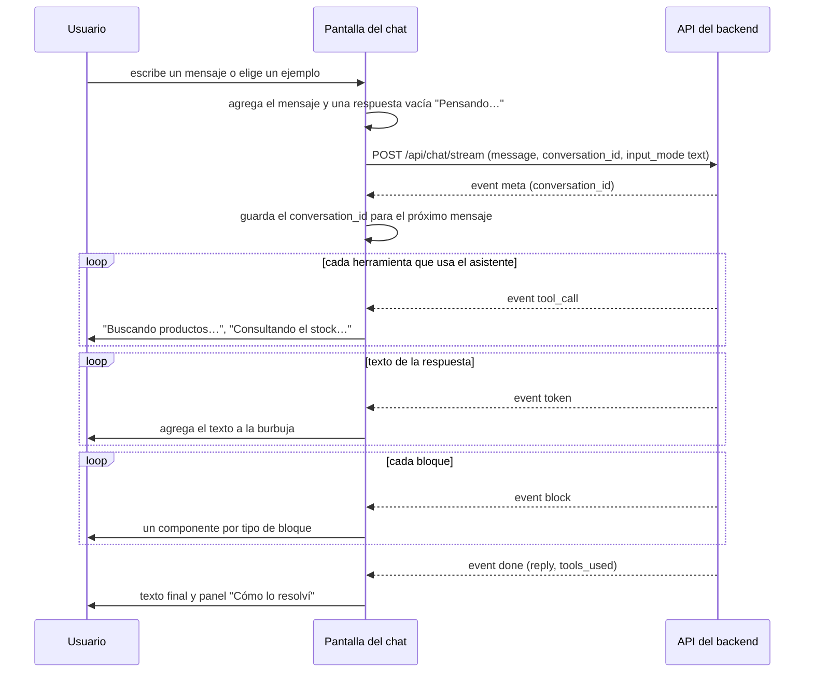
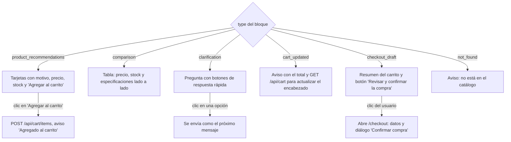
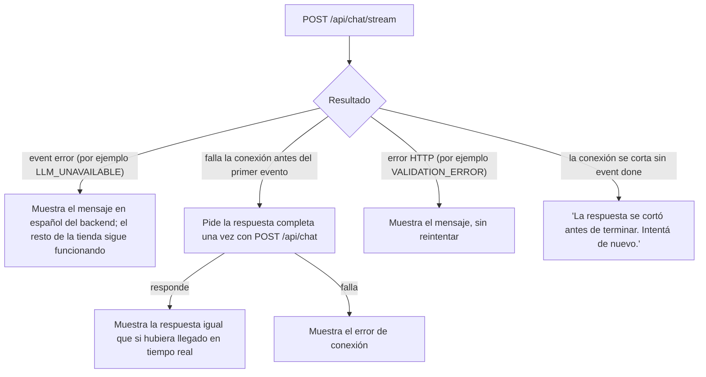

# Flujo del chat en la interfaz

Este diagrama muestra lo que hace la pantalla del asistente (`/chat`) y qué endpoints llama. Lo que pasa dentro de `POST /api/chat/stream` está en `chat-flow.md`.

## 1. Un mensaje, de punta a punta

La pantalla lee la respuesta con `fetch` y no con `EventSource`, porque el pedido es un POST (ver el contrato de la API, sección "Asistente"). Cada evento se muestra apenas llega: el usuario ve qué herramienta está usando el asistente y el texto mientras se escribe.

## 2. Qué hace cada bloque

El chat nunca confirma una compra. El bloque `checkout_draft` solo lleva a la pantalla de checkout, donde la orden se registra únicamente con el clic en "Confirmar compra" (confirmación explícita de la compra, RF-12). Las respuestas rápidas solo funcionan en la última respuesta, para no contestar dos veces la misma pregunta.

## 3. Qué muestra la pantalla cuando algo falla

Mientras una respuesta se escribe, el botón "Enviar" queda deshabilitado: el asistente atiende un mensaje por vez. La conversación vive en la memoria de la aplicación, así que se mantiene al ir al carrito y volver, pero se pierde al recargar la página.
