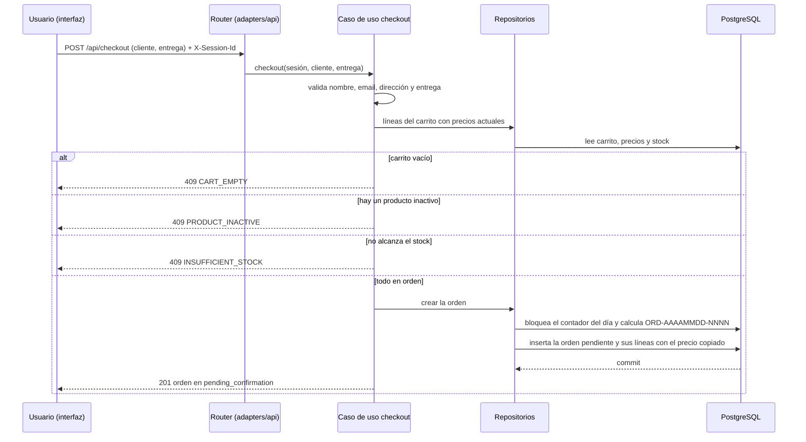
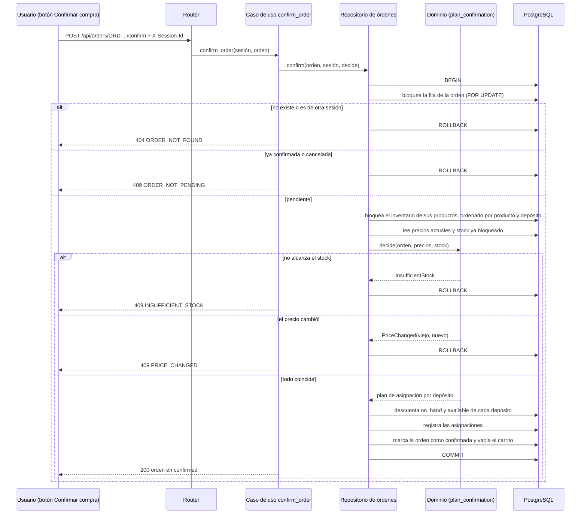
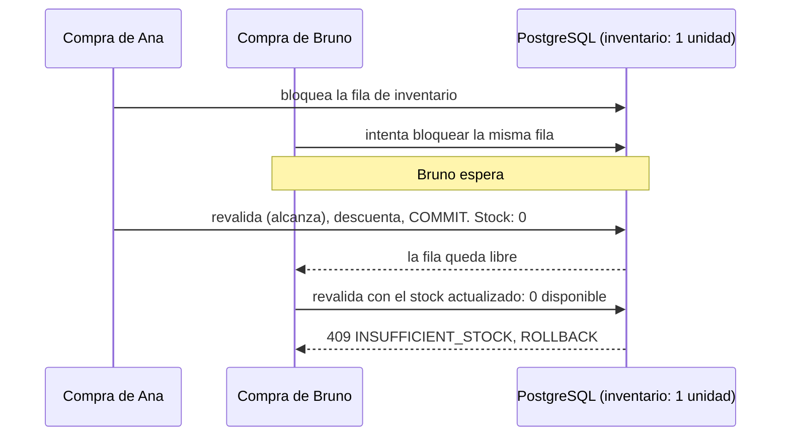
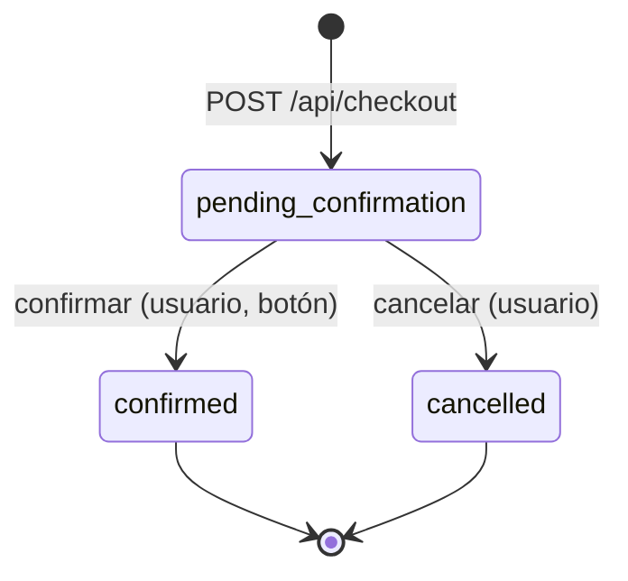
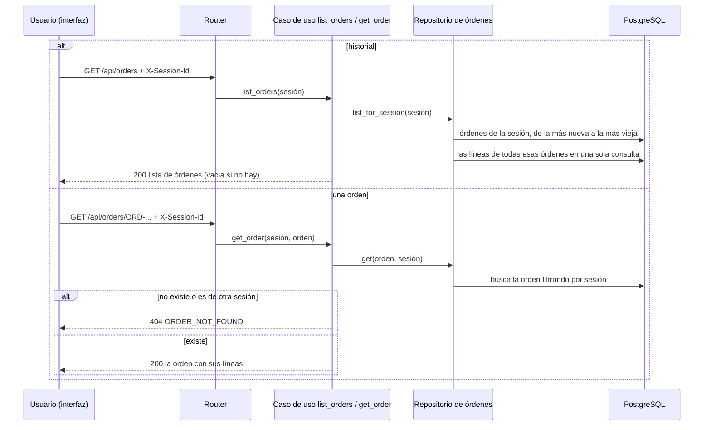
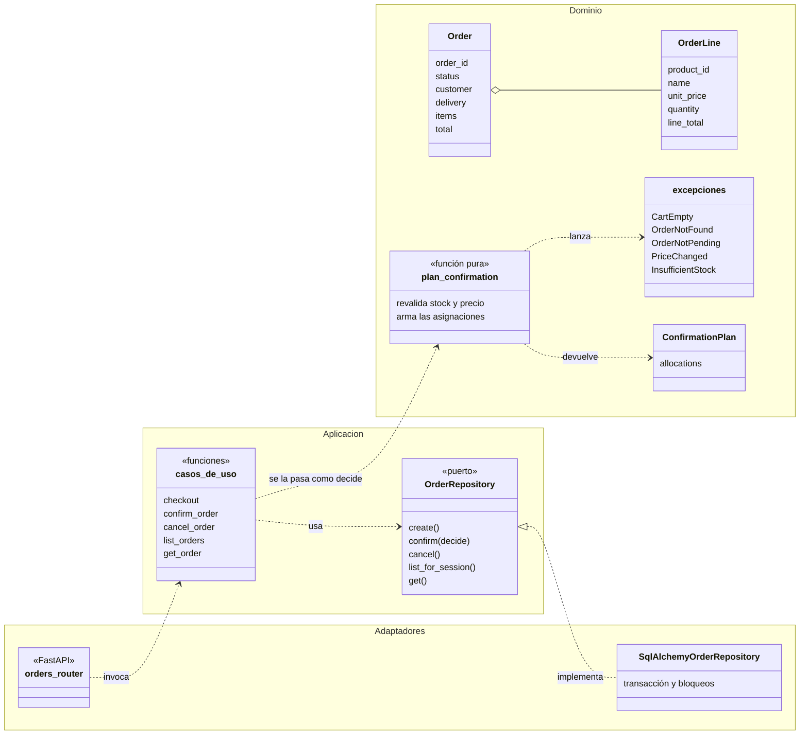

# Flujo de la compra

Estos diagramas muestran lo que está implementado en el checkout y la confirmación (decisión 0007). La compra se hace en dos pasos, y **solo el usuario**, con un botón de la interfaz, ejecuta el segundo.

## 1. Paso 1: crear la orden pendiente

`POST /api/checkout`

En este paso **no se descuenta stock, no se reserva nada y el carrito no se vacía**. La orden pendiente es un borrador sin efectos.

## 2. Paso 2: confirmar (una sola transacción)

`POST /api/orders/{order_id}/confirm`, que se ejecuta cuando el usuario hace clic en "Confirmar compra".

Si cualquier paso falla, la transacción se deshace entera: o se confirma todo, o no cambia nada.

## 3. Dos personas confirman la última unidad a la vez

Hay un test con dos hilos reales que reproduce esta carrera: siempre una compra tiene éxito, la otra recibe `INSUFFICIENT_STOCK` y el stock nunca queda negativo.

## 4. Estados de la orden

`confirmed` y `cancelled` son finales: confirmar o cancelar de nuevo da `ORDER_NOT_PENDING`.

## 5. Historial de órdenes (RF-16)

`GET /api/orders` devuelve las órdenes de la sesión, de la más nueva a la más vieja. `GET /api/orders/{order_id}` devuelve una sola. Las dos son de solo lectura.

El historial incluye órdenes en los tres estados: pendientes, confirmadas y canceladas. Cada línea muestra el nombre y el precio copiados al crear la orden. Si después cambia el precio o el nombre del producto, el historial sigue mostrando lo que se pagó (precio congelado en la orden, RF-14). Una sesión nunca ve las órdenes de otra: buscar una orden ajena responde lo mismo que una que no existe.

## 6. Clases

El repositorio es dueño de la transacción y de los bloqueos. El dominio es dueño de las decisiones y no sabe nada de la base: recibe el stock y los precios ya leídos y devuelve un plan.
