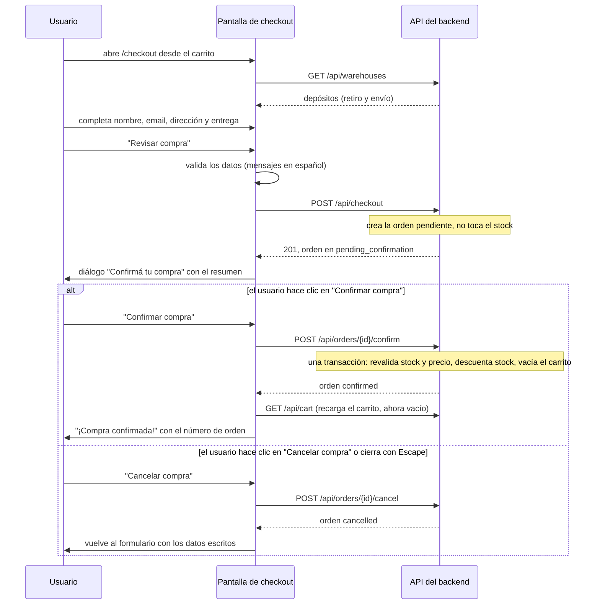
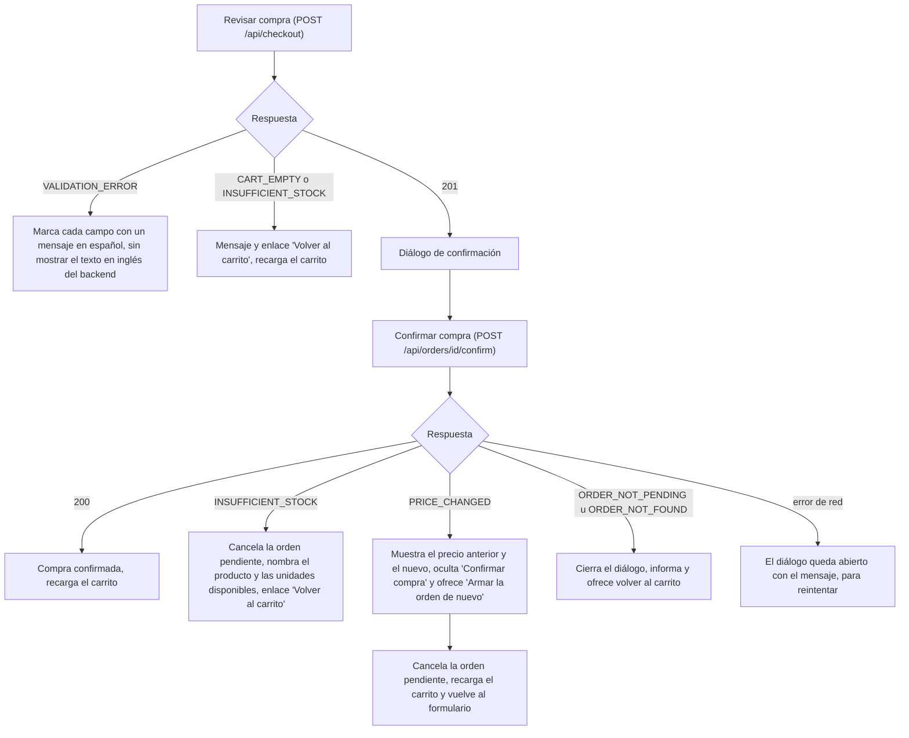

# Flujo de la compra en la interfaz

Este diagrama muestra lo que hace la pantalla de checkout (`/checkout`) y qué endpoints llama. El flujo del backend (qué pasa dentro de cada endpoint) está en `checkout-flow.md`.

## 1. De "Continuar con la compra" a la compra confirmada

La orden se crea al enviar el formulario, pero **solo se confirma con el clic en "Confirmar compra"** (confirmación explícita, RF-12). Antes de llamar a la API, la pantalla valida los datos en español (nombre, email y dirección no vacíos, email con formato válido, largos máximos).

## 2. Qué muestra la pantalla cuando algo falla

Mientras hay un pedido en curso, los botones quedan deshabilitados y se ignoran los clics repetidos: una orden no se envía ni se confirma dos veces. Nombre, email y dirección solo viajan en el cuerpo de `POST /api/checkout`: no se escriben en la consola ni se guardan en el navegador.
