# Modelo de datos

Este documento describe las tablas de PostgreSQL que usa el backend. Las crea la migración inicial de Alembic (`backend/migrations/versions/0001_initial_schema.py`) a partir de los modelos de `backend/app/adapters/persistence/orm/`.

Las tablas se agrupan en cuatro partes:

| Grupo | Tablas | Origen | Tipo de dato |
|---|---|---|---|
| Catálogo | `brands`, `categories`, `products`, `product_specifications`, `product_relations`, `product_embeddings` | Dataset de MercaNova (las embeddings se calculan a partir de él) | Estático |
| Precio y stock | `prices`, `warehouses`, `inventory` | Dataset de MercaNova | Dinámico |
| Compra | `carts`, `cart_items`, `orders`, `order_items`, `order_allocations` | Entidades nuevas, no están en el dataset | Dinámico |
| Conversación | `conversations`, `messages` | Entidades nuevas, no están en el dataset | Dinámico |

## Diagrama entidad-relación

PK es la clave primaria, FK una clave foránea y UK un valor único.

```mermaid
erDiagram
    brands ||--o{ products : "fabrica"
    categories |o--o{ products : "clasifica"
    products ||--o{ product_specifications : "tiene"
    products ||--o{ product_relations : "origen"
    products ||--o{ product_relations : "relacionado"
    products ||--o| product_embeddings : "se indexa en"
    products ||--o| prices : "tiene"
    products ||--o{ inventory : "tiene stock en"
    warehouses ||--o{ inventory : "guarda"
    carts ||--o{ cart_items : "contiene"
    products ||--o{ cart_items : "aparece en"
    orders ||--o{ order_items : "contiene"
    products ||--o{ order_items : "aparece en"
    warehouses |o--o{ orders : "retiro en"
    order_items ||--o{ order_allocations : "se descuenta de"
    warehouses ||--o{ order_allocations : "aporta unidades"
    conversations ||--o{ messages : "contiene"

    brands {
        string brand_id PK
        text brand_name
        text country_of_origin
        text positioning
    }
    categories {
        string subcategory_id PK
        text subcategory_name UK "único junto con category_name"
        string category_id
        text category_name UK
        text department
        int sort_order
    }
    products {
        string product_id PK
        string sku UK
        text name
        string brand_id FK
        string subcategory_id FK "puede ser nulo"
        text category_name
        text subcategory_name
        text short_description
        text description
        text_array recommended_for
        text_array not_recommended_for
        text_array key_features
        text_array tags
        text color
        numeric weight_kg
        numeric width_cm
        numeric height_cm
        numeric depth_cm
        int warranty_months
        int return_days
        numeric rating "entre 0 y 5"
        int review_count
        date launch_date
        bool active
        text image_url
    }
    product_specifications {
        int id PK
        string product_id FK
        text attribute_group
        text attribute_name
        text value_text
        numeric value_number
        text unit
    }
    product_relations {
        string product_id PK, FK
        string related_product_id PK, FK
        string relation_type PK
        numeric strength "entre 0 y 1"
    }
    product_embeddings {
        string product_id PK, FK
        text content
        vector embedding "768 dimensiones"
        text model
        timestamptz updated_at
    }
    prices {
        string product_id PK, FK
        string currency
        numeric list_price "NUMERIC(10,2)"
        numeric current_price "NUMERIC(10,2)"
        numeric discount_percent "entre 0 y 100"
        bool tax_included
        timestamptz price_updated_at
    }
    warehouses {
        string warehouse_id PK
        text warehouse_name
        text city
        text department
        text country
        bool pickup_enabled
        bool shipping_enabled
    }
    inventory {
        string product_id PK, FK
        string warehouse_id PK, FK
        int on_hand_qty "mayor o igual a 0"
        int reserved_qty "mayor o igual a 0"
        int available_qty "mayor o igual a 0"
        text inventory_status
        timestamptz inventory_updated_at
    }
    carts {
        uuid cart_id PK
        string session_id UK
        timestamptz created_at
        timestamptz updated_at
    }
    cart_items {
        uuid cart_id PK, FK
        string product_id PK, FK
        int quantity "mayor que 0"
        timestamptz added_at
    }
    orders {
        string order_id PK "ORD-AAAAMMDD-NNNN"
        string session_id
        string status "pending_confirmation, confirmed o cancelled"
        text customer_name
        text customer_email
        text customer_address
        string delivery_method "pickup o shipping"
        string warehouse_id FK "obligatorio si es pickup"
        numeric total "NUMERIC(10,2)"
        string currency
        timestamptz created_at
        timestamptz confirmed_at
        timestamptz cancelled_at
    }
    order_items {
        string order_id PK, FK
        string product_id PK, FK
        text product_name "copia al crear la orden"
        numeric unit_price "copia al crear la orden"
        int quantity "mayor que 0"
        numeric line_total
    }
    order_allocations {
        string order_id PK, FK
        string product_id PK, FK
        string warehouse_id PK, FK
        int quantity "mayor que 0"
    }
    conversations {
        uuid conversation_id PK
        string session_id
        timestamptz created_at
    }
    messages {
        int id PK
        uuid conversation_id FK
        string role "user, assistant o tool"
        text content
        jsonb blocks
        jsonb tool_calls
        timestamptz created_at
    }
```

`session_id` aparece en `carts`, `orders` y `conversations`, pero no es una clave foránea: no hay tabla de usuarios porque la letra deja el login fuera del alcance. Es el identificador que el navegador genera y envía en el encabezado `X-Session-Id`, como define el contrato de la API (`docs/api-contract.md`).

## Catálogo (estático)

Son los datos que describen cada producto y casi no cambian: nombre, marca, categoría, descripciones, para qué se recomienda, características y especificaciones técnicas.

- `products` guarda los campos del dataset. Las columnas `recommended_for`, `not_recommended_for`, `key_features` y `tags` vienen en el dataset como texto separado por `;`. Se guardan como listas (`text[]`) para poder filtrarlas sin volver a separar el texto.
- `categories` tiene una fila por subcategoría, como en el dataset, y repite la categoría padre en cada fila. El dataset no trae el identificador de subcategoría en cada producto. Por eso `products.subcategory_id` se completa al cargar los datos, buscando el par categoría y subcategoría por nombre. Ese par es único en `categories`.
- `product_specifications` guarda las especificaciones técnicas como filas atributo y valor (por ejemplo, "Screen Size" = 24 "in"). No se repite el mismo atributo para un producto.
- `product_relations` guarda las relaciones entre productos del dataset: alternativa (`alternative_to`), accesorio (`accessory_for`) y comprados juntos (`often_bought_with`), con una fuerza entre 0 y 1.
- `product_embeddings` guarda un vector de 768 números por producto, calculado a partir del texto estático con el modelo `nomic-embed-text`. Sirve para la búsqueda por significado (RAG). Por ahora la tabla está vacía; se llena cuando se implementa la búsqueda semántica.

**Este es el único grupo que puede ir a la búsqueda semántica.** El texto que se convierte en vector no incluye precio ni stock.

## Precio y stock (dinámico)

- `prices` guarda el precio de lista, el precio actual y el descuento de cada producto. Los montos usan `NUMERIC(10,2)`, un tipo decimal exacto, para no tener errores de redondeo como con los números de punto flotante.
- `warehouses` son los cinco depósitos del dataset, con si permiten retiro y envío.
- `inventory` guarda el stock de cada producto en cada depósito. La base rechaza cantidades negativas: una venta nunca puede dejar `available_qty` por debajo de 0.

**Estos datos nunca se guardan en los vectores ni en el contexto del modelo de lenguaje.** El asistente solo los conoce a través de una herramienta que los lee de la base en el mismo turno. Así lo pide la letra para la información actual de precio y stock (RF-07) y para no inventar datos (RF-18).

## Compra (dinámico, entidades nuevas)

El dataset no trae carritos ni órdenes. Estas tablas se agregaron para cumplir con la compra completa. La justificación está en la decisión `docs/decisions/0002-entidades-nuevas.md`.

- `carts` y `cart_items`: un carrito por sesión. La base rechaza cantidades menores a 1.
- `orders`: la orden con los datos del cliente y la forma de entrega. La base solo acepta los estados `pending_confirmation`, `confirmed` y `cancelled`, y exige un depósito cuando la entrega es por retiro (`pickup`).
- `order_items`: las líneas de la orden. El nombre y el precio unitario se **copian** al crear la orden. Si después cambia el precio del producto, el historial sigue mostrando lo que pagó el usuario.
- `order_allocations`: de qué depósito salió cada unidad confirmada. Cada fila apunta a una línea existente de `order_items`.

## Conversación (dinámico, entidades nuevas)

- `conversations`: una conversación con el asistente, asociada a la sesión del navegador.
- `messages`: cada mensaje, con su rol (`user`, `assistant` o `tool`), el texto, los bloques visuales que se mostraron (tarjetas, comparaciones, confirmación de compra) y las herramientas que se llamaron. Con esto se puede restaurar el chat si el usuario recarga la página, y mostrar qué herramientas usó el asistente para responder.

## Reglas que controla la propia base

Estas reglas están en la base como restricciones (`CHECK`, claves foráneas y valores únicos). Se cumplen aunque un error en el código intente guardar datos inválidos. Hay tests automáticos que lo verifican (`backend/tests/integration/test_constraints.py`).

| Regla | Tabla |
|---|---|
| El stock disponible no puede ser negativo | `inventory` |
| La cantidad en el carrito es al menos 1 | `cart_items` |
| El estado de la orden es uno de los tres permitidos | `orders` |
| Una orden con retiro tiene un depósito | `orders` |
| Una asignación de stock corresponde a una línea de orden existente | `order_allocations` |
| Precios, descuentos y puntajes dentro de rangos válidos | `prices`, `products`, `product_relations` |
