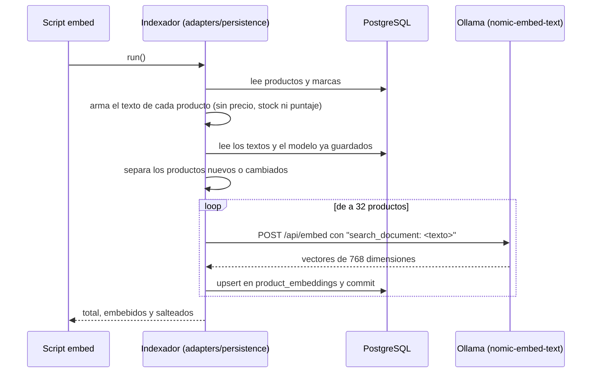
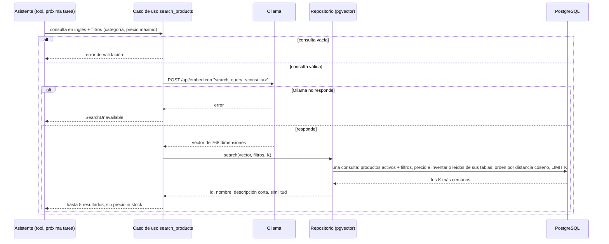
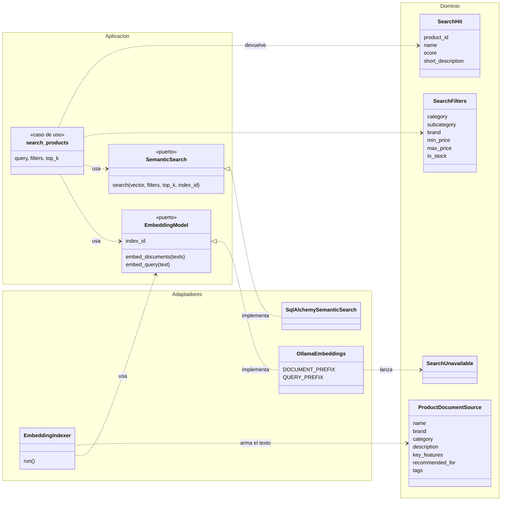

# Flujo de la búsqueda por significado

Estos diagramas muestran lo que está implementado en la búsqueda semántica (decisión 0004). La herramienta que la expone al asistente todavía no existe: hoy se usa el caso de uso `search_products` directamente.

## 1. Indexar los productos (una sola vez al cargar el catálogo)

`make embed`

Si se corre otra vez sin cambios, la lista de productos nuevos o cambiados queda vacía y no llama a Ollama.

## 2. Buscar (cada consulta del asistente)

El precio y el stock del resultado los consulta después la herramienta de precio y stock, siempre en el mismo turno.

## 3. Clases y capas

Cada capa solo conoce a la de adentro a través de una interfaz (puerto). El dominio no importa FastAPI, SQLAlchemy ni Ollama. Los adaptadores implementan los puertos.

`ProductDocumentSource` no tiene precio, stock ni puntaje: es lo que garantiza que esos datos nunca entren al índice. El prefijo del modelo (`search_document:` y `search_query:`) vive solo en `OllamaEmbeddings`.
