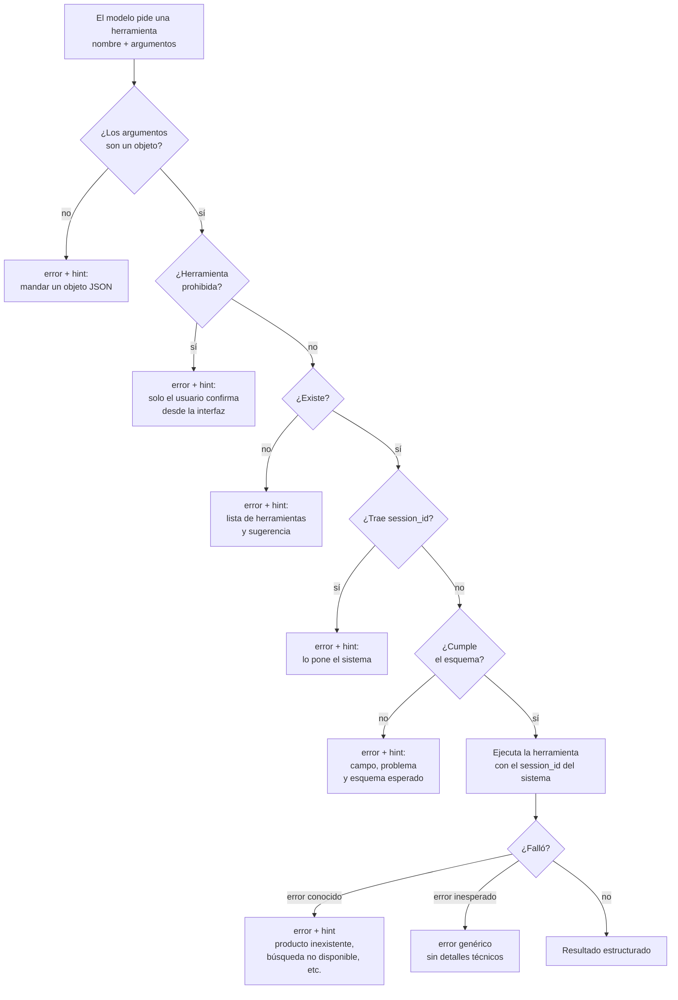
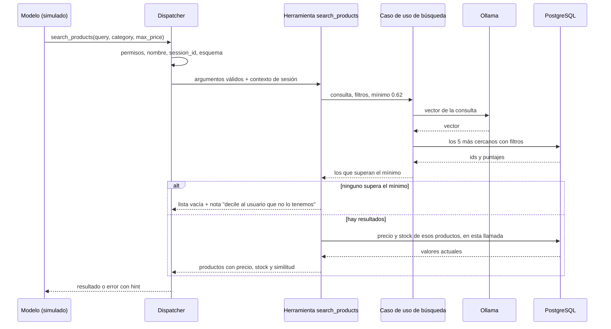
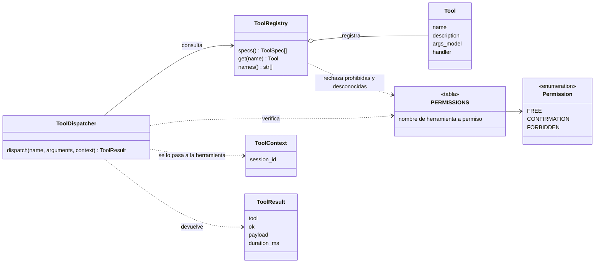

# Flujo de una herramienta del asistente

Estos diagramas muestran lo que está implementado en el dispatcher y las herramientas de lectura (decisión 0005). El ciclo del agente que llama al dispatcher es otra tarea: hoy se invoca directamente.

## 1. Qué comprueba el dispatcher antes de ejecutar

Todos los errores tienen la misma forma, `{"error": ..., "hint": ...}`, y vuelven al modelo para que corrija el pedido. El dispatcher nunca lanza una excepción hacia el usuario.

## 2. Una búsqueda de punta a punta

El caso de uso 1: "auriculares para videollamadas, máximo USD 200".

El precio y el stock no salen del índice: se leen de sus tablas cada vez que se ejecuta la herramienta.

## 3. Clases

`ToolContext` lo arma el sistema, no el modelo. El registro se niega a aceptar `confirm_order` y `cancel_order`: por eso no existe ningún camino por el que el modelo pueda confirmar una compra.
