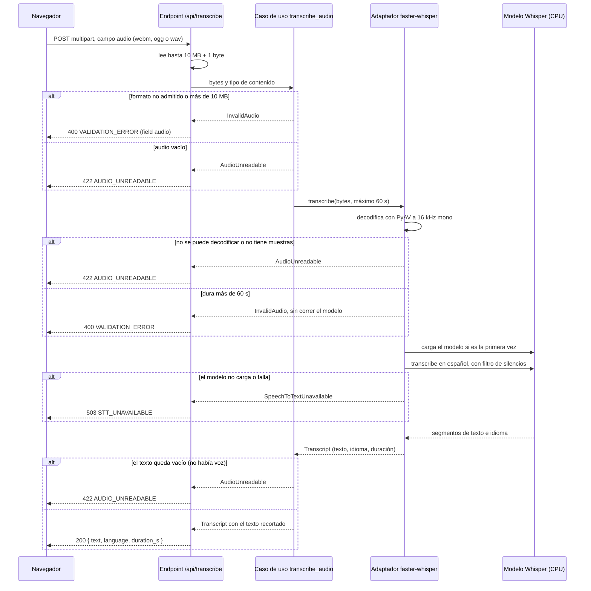

# Flujo de voz a texto

Este diagrama muestra lo que está implementado en `POST /api/transcribe`, la entrada por voz que pide la letra (RF-08). El endpoint solo convierte el audio en texto. Después, el frontend manda ese texto a `/api/chat/stream` con `input_mode: "voice"`, y la consulta sigue el mismo camino que una escrita (ver `chat-flow.md`). El botón de voz del frontend todavía no existe.

La transcripción corre en el mismo contenedor del backend, con faster-whisper en CPU (decisión 0001). El modelo (`STT_MODEL`, por defecto `small`) se descarga la primera vez que se usa y queda en el volumen `whisper_models`. Se carga una sola vez por proceso.

Los mensajes de error que ve el usuario están en español y nunca incluyen el detalle técnico de la falla. Ese detalle queda solo en el log del backend.
