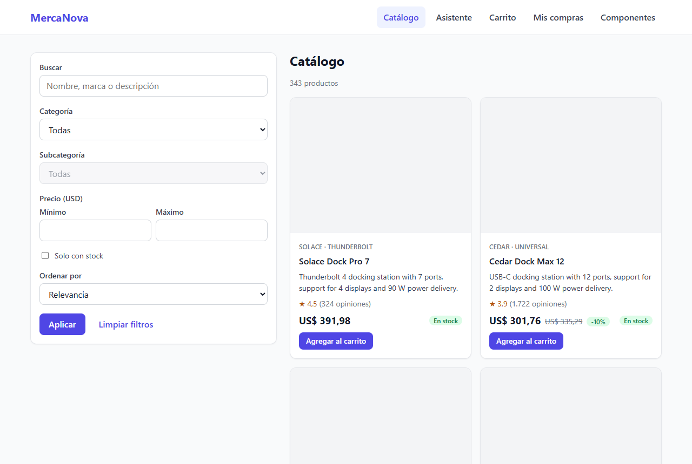
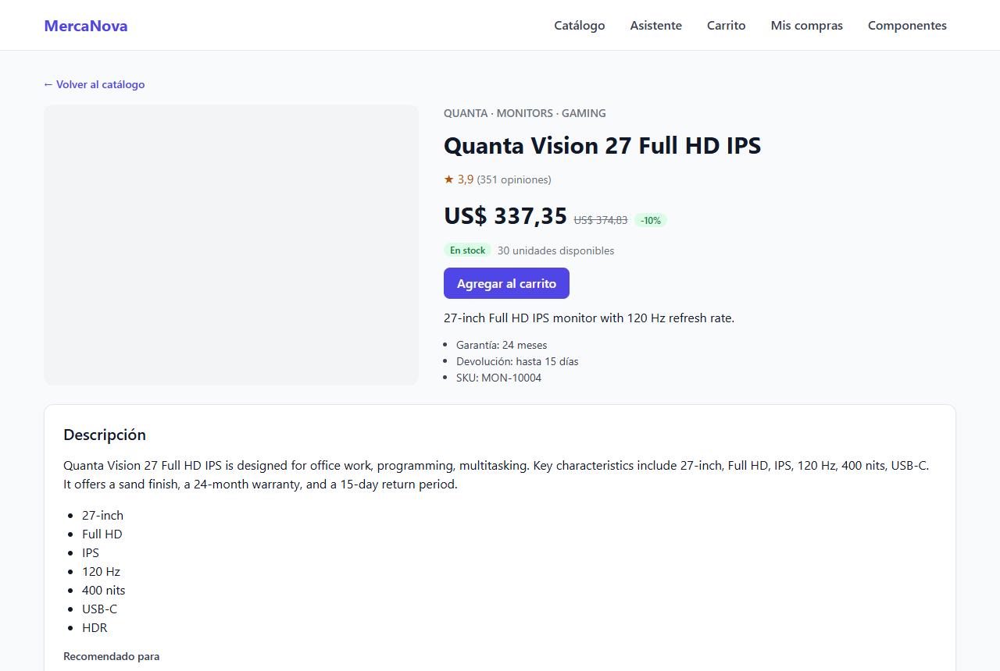
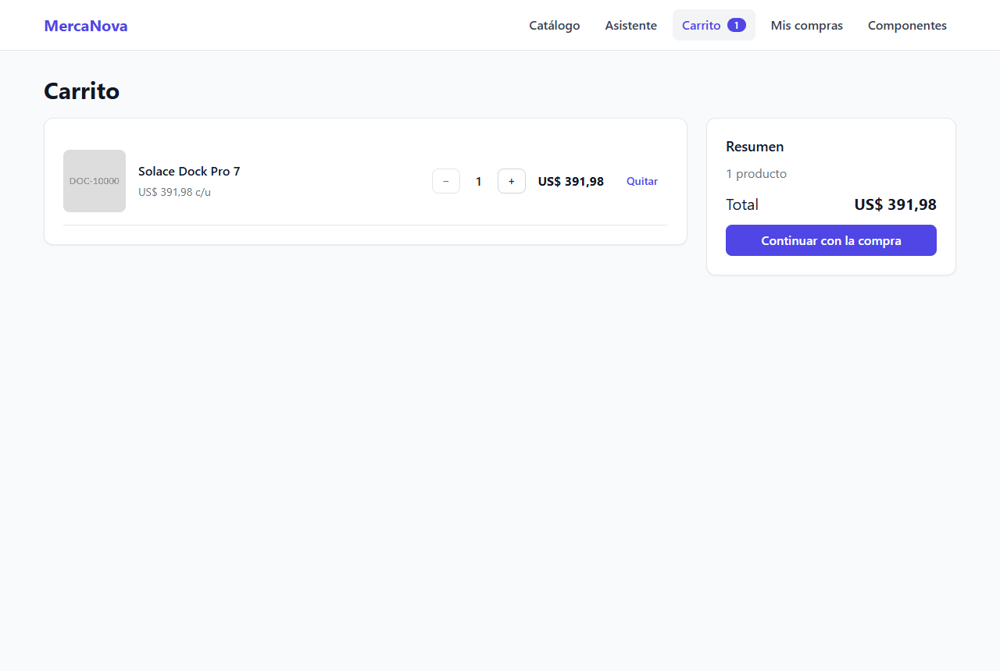
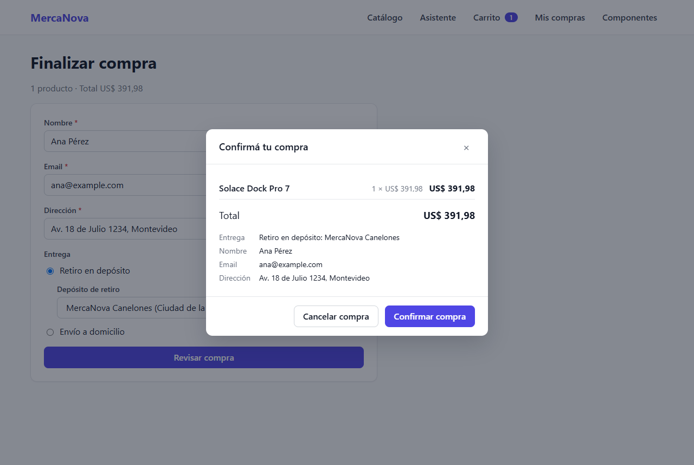
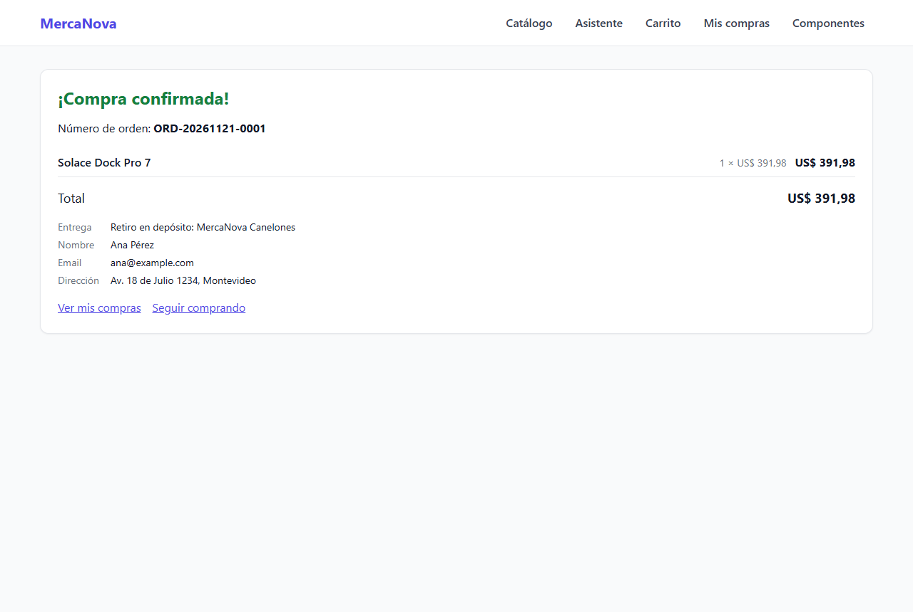
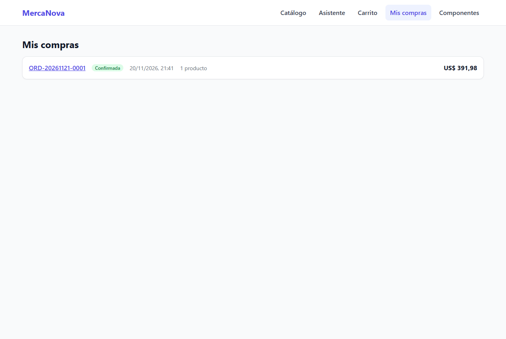

# Frontend, testing, coding agents, ejecución, limitaciones y links

## 1. Frontend

La interfaz es una aplicación React con Vite y TypeScript. Tiene cinco pantallas: catálogo, detalle de producto, asistente (chat), carrito con checkout, e historial de compras. Toda la interfaz está en español.

**Cómo está organizada.**
- **Design tokens.** Colores, espacios y tipografía se definen una sola vez, en `frontend/src/theme/tokens.ts`. Ningún componente usa un color o un tamaño escrito a mano. La pantalla "Componentes" (`/ui`) muestra los componentes base con esos tokens.
- **Componentes de presentación separados de los que cargan datos.** Los componentes de presentación reciben datos y acciones por props, y no llaman a la API. Los contenedores y los hooks (`useCart`, `useChat`) cargan los datos y manejan los estados de carga, error y vacío.
- **El servidor es la fuente de verdad.** El carrito, el total, el precio y el stock que se muestran son los que devuelve el backend. Después de cada cambio, la pantalla reemplaza el carrito por la respuesta del servidor.

**Capturas.** Tomadas el 20/11/2026 de la aplicación levantada con Docker Compose y el catálogo del dataset. Las imágenes de producto aparecen como recuadros grises porque el dataset trae URLs de imágenes de ejemplo (`placehold.co`).

**Catálogo.** Búsqueda por texto, filtros por categoría, subcategoría, rango de precio y "Solo con stock", y orden. Cada tarjeta muestra precio, descuento, calificación, si hay stock y el botón "Agregar al carrito".

**Detalle de producto.** Precio actual y de lista, unidades disponibles, garantía, devolución, descripción, características y para quién se recomienda.

**Asistente.** Caso de uso 1, respondido por el modelo real (`qwen3:8b`): el usuario describe lo que necesita y el asistente recomienda productos del catálogo, con el motivo de cada recomendación y el precio leído de la base. El panel "Cómo lo resolví" muestra las herramientas que usó.

> **PENDIENTE (captura a cargo de Agustín).** Agregar `docs/report/assets/03-chat-recommendations.png`: captura de página completa de `/chat` respondiendo el caso de uso 1 con `qwen3:8b`, con la respuesta terminada y el panel "Cómo lo resolví" visible. Después, reemplazar esta nota por ``.

**Carrito.** Cantidades con límite en el stock disponible, total calculado por el servidor y "Continuar con la compra".

**Confirmación explícita de compra (RF-12).** Después de completar los datos, el diálogo "Confirmá tu compra" muestra la orden pendiente. Solo el botón "Confirmar compra" la registra.

**Compra confirmada.** Número de orden, detalle y forma de entrega.

**Historial ("Mis compras").** Órdenes de la sesión, de la más nueva a la más vieja, con su estado.

## 2. Testing

La estrategia completa está en `docs/testing-strategy.md`. En resumen:

| Nivel | Qué prueba | Herramienta |
|---|---|---|
| Dominio | Reglas de negocio sin base ni modelo: carrito, stock, estado de la orden | pytest |
| Integración | La API contra PostgreSQL real: catálogo, carrito, checkout en dos pasos, historial y confirmaciones simultáneas del mismo producto | pytest + httpx |
| Agente, determinista | El ciclo del asistente con un modelo simulado: qué herramientas se ejecutan, con qué argumentos, y que la respuesta use solo datos de esas herramientas | pytest |
| Agente, evaluación | 20 casos fijos contra el modelo real, con puntaje por métrica: resultado de la tarea, herramienta correcta, datos respaldados por herramientas, costo y latencia | `tests/eval/runner.py` |
| Frontend | Componentes y recorridos críticos con APIs simuladas, por ejemplo del chat a la compra confirmada | Vitest + Testing Library |

**Evidencia.**
- Al 20/11/2026 hay 962 tests de backend y 241 de frontend, todos en verde.
- **CI:** GitHub Actions corre en cada pull request el lint (ruff y oxlint), el chequeo de tipos, los tests de backend contra PostgreSQL con pgvector y los de frontend. El plan del repositorio no permite exigir el CI en verde para mergear, así que lo comprueba quien revisa.
- **Evaluación del asistente:** se compararon dos modelos locales en los 20 casos, con 3 corridas por caso. Con `qwen3:8b`, el modelo elegido, el asistente cumplió el resultado esperado en el 85 % de las condiciones y usó la herramienta correcta en el 92,5 %. El 100 % de los montos e identificadores de las respuestas salieron de una herramienta o del texto del usuario. El detalle está en `docs/model-comparison.md`.
- **Cada corrección trae su test.** Cada error corregido incluye un test que lo reproduce: el test falla sin la corrección y pasa con ella.

**Qué no se cubre automáticamente.** La voz se probó a mano en Chrome con un micrófono real. El frontend se prueba con APIs simuladas y no hay una prueba automática de punta a punta con navegador. El recorrido del chat a la compra se comprobó a mano contra el backend y el modelo reales.

## 3. Uso de coding agents

El proyecto se construyó con coding agents (Claude Code y Pi), bajo reglas escritas y con revisión humana de lo que generan. Cada pull request declara en su descripción qué agente se usó y qué partes se escribieron o corrigieron a mano.

**`AGENTS.md`.** Es el archivo de reglas que todo agente lee antes de cada tarea. Define:
- el stack y la organización del repositorio;
- las reglas de arquitectura que no se negocian: precio y stock siempre de la base, confirmación de compra fuera del modelo, backend hexagonal, frontend con tokens, stock transaccional;
- las reglas del asistente: permisos por herramienta, estado explícito, controles de entrada y de salida, observabilidad;
- el flujo de trabajo: issue → rama → commits → pull request → revisión;
- cómo se prueba, el idioma de cada cosa y las reglas de la documentación.

La justificación de cada regla, con su fuente, está en `docs/agent-practices.md`.

**Skills.** Son procedimientos escritos para tareas que se repiten, en `.claude/skills/`. No son herramientas del asistente de compras.

| Skill | Para qué |
|---|---|
| `backend-feature` | Agregar un endpoint, una regla de dominio, un repositorio o una herramienta del agente, respetando la arquitectura hexagonal. Incluye lecciones aprendidas, por ejemplo "hacer cumplir las reglas en el software, no en el prompt" |
| `testing` | Escribir tests unitarios, de integración y casos de evaluación del agente |
| `frontend-component` | Crear componentes y pantallas con design tokens y la separación presentación/contenedor |
| `code-review` | Revisar un pull request con un checklist: requisitos, arquitectura, robustez, tests y documentación |

**Hooks: controles automáticos.** Antes de cada edición o comando del agente corre `.claude/hooks/guard.py`, que bloquea cuatro cosas:
- escribir archivos de secretos (`.env`, claves);
- hacer commit o push directo a `main`;
- hacer un *force push*;
- subir el dataset de la cátedra.

**Flujo de trabajo.**
1. Cada tarea empieza como una issue con una plantilla (`.github/ISSUE_TEMPLATE/task.yml`): contexto, qué hay que hacer, para qué sirve, qué está fuera de alcance, cuándo está terminada y cómo se trabaja. Es el "ticket" que recibe el agente.
2. Cada tarea va en su rama, con commits en formato Conventional Commits.
3. Cada tarea termina en un pull request con plantilla. La regla es que lo revise la otra persona del equipo antes de mergearlo.
4. Si el cambio agrega o modifica un flujo, el mismo pull request actualiza su diagrama en `docs/diagrams/`.
5. Las decisiones de arquitectura quedan como ADR en `docs/decisions/`.

Al 20/11/2026 había 55 issues y 41 pull requests mergeados.

**Cómo revisamos el código generado.** Además del checklist de la skill `code-review`, quien revisa se hace las preguntas de `AGENTS.md`:
- ¿El agente inventó arquitectura o datos?
- ¿Hay complejidad innecesaria?
- ¿Los archivos tocados son razonables para la tarea?
- ¿El diff es chico como para revisarlo?
- ¿Lo mergearía sin leerlo? Si la respuesta es sí, hay que leerlo.

Las observaciones que no bloquean se convierten en issues nuevas para no perderlas. Por ejemplo, las observaciones de la revisión del frontend de compra, chat y voz quedaron en su propia issue, con un test o una nota por cada punto.

## 4. Cómo ejecutarlo

**Requisitos.**
- Docker Desktop con al menos 8 GB de memoria asignada.
- El Excel de la cátedra (`MercaNova_dataset_obligatorio_2.xlsx`), copiado en la carpeta `data/` de la raíz. No se guarda en el repositorio.
- Conexión a internet la primera vez, para descargar las imágenes de Docker, el modelo de lenguaje (`qwen3:8b`, 5,2 GB), el de embeddings (`nomic-embed-text`, 274 MB) y, en la primera transcripción de voz, el modelo `small` de faster-whisper (unos 460 MB).

**Pasos.** Con `make` instalado (macOS o Linux), los comandos son los de la columna del medio. En Windows sin `make`, se usan los de la derecha.

| Paso | Con `make` | Sin `make` |
|---|---|---|
| Configuración local | `cp .env.example .env` | `copy .env.example .env` |
| Levantar todo | `make up` | `docker compose up -d --build` |
| Crear las tablas | `make migrate` | `docker compose exec backend alembic upgrade head` |
| Descargar los modelos (solo la primera vez) | `make pull-models` | `docker compose exec ollama ollama pull qwen3:8b` y `docker compose exec ollama ollama pull nomic-embed-text` |
| Cargar el catálogo | `make seed` | `docker compose exec backend python -m app.scripts.seed` |
| Generar los vectores de búsqueda | `make embed` | `docker compose exec backend python -m app.scripts.embed` |

**Dónde probarlo.**

| Qué | Dónde |
|---|---|
| Aplicación (catálogo, carrito, historial) | http://localhost:5173 |
| Asistente, por texto o por voz (Chrome, con permiso de micrófono) | http://localhost:5173/chat |
| API del backend, con documentación interactiva | http://localhost:8000/docs |
| Tests | `make test`, o `docker compose exec backend pytest` y `cd frontend && npm test -- --run` |

**Velocidad del asistente.** Dentro de Docker, Ollama corre solo en el procesador, y cada respuesta puede tardar minutos. Con Ollama instalado directamente en la máquina y una GPU con memoria suficiente, tarda segundos (en una Apple M1 Max, unos 33 tokens por segundo y de 8 a 11 segundos por turno). El README explica cómo apuntar el backend a ese Ollama con la variable `OLLAMA_BASE_URL`.

## 5. Limitaciones

- **Latencia y hardware.** El modelo elegido (`qwen3:8b`) necesita unos 6 GB de memoria. En una notebook con una GPU de 4 GB (RTX 3050) no entra entero en la placa: medimos 1,2 tokens por segundo, y una respuesta tarda más de un minuto. La alternativa más chica que teníamos instalada (`qwen3:4b`, versión 2507) no permite apagar el razonamiento y no termina dentro del tiempo máximo del turno.
- **El modelo no es determinista.** El mismo pedido puede dar respuestas distintas. Las conclusiones de la evaluación valen por la tendencia de varias corridas. Las reglas críticas las controla el software: los precios y el stock salen de la base, y la compra necesita el clic del usuario.
- **Sin usuarios.** No hay inicio de sesión. Cada navegador tiene un identificador de sesión propio (guardado en el navegador) con su carrito y sus órdenes. La conversación con el asistente no se conserva al recargar la página.
- **Idioma del catálogo.** El dataset está en inglés y la interfaz en español. La búsqueda por significado funciona porque el asistente escribe la consulta de búsqueda en inglés. La búsqueda por texto del catálogo compara palabras y espera términos en inglés o nombres de producto.
- **Voz.** Se probó solo en Chrome. La primera transcripción descarga el modelo de voz y necesita internet.
- **Imágenes.** El dataset trae URLs de imágenes de ejemplo, no fotos reales de los productos.
- **El hook no cubre todo.** Bloquea editar `.env` con las herramientas de edición del agente, pero no detecta un comando de la terminal que lo modifique (por ejemplo `sed`). La regla de no subir secretos se sostiene también con `.gitignore` y con la revisión de cada pull request.

## 6. Links

| Qué | Link |
|---|---|
| Repositorio (privado, con acceso para los docentes) | https://github.com/Saikus08/mercanova-ai-assistant |
| Video de demostración | PENDIENTE: se agrega cuando esté grabado |
| Reglas para coding agents | `AGENTS.md`, en la raíz del repositorio |
| Decisiones de diseño (ADR) | `docs/decisions/` |
| Diagramas de cada flujo | `docs/diagrams/` |
| Estrategia de testing | `docs/testing-strategy.md` |
| Comparación de modelos | `docs/model-comparison.md` |
| Casos de uso | `docs/use-cases.md` |
| Contrato de la API | `docs/api-contract.md` |
